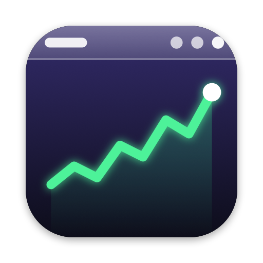

<p align="center">
  
</p>

<h1 align="center">Topline</h1>

<p align="center"><b>Your Mac menu bar, rebuilt.</b><br>
Live markets, your apps and trays, every menu bar icon — and the features macOS never shipped.</p>

<p align="center">
  <a href="https://github.com/Rikinshah787/topline/actions/workflows/build.yml"></a>
  
  
  <a href="LICENSE"></a>
</p>

---

Topline sits exactly where the macOS menu bar is and replaces it with one you control. It keeps everything you rely on (the Apple menu, the active app's File / Edit / View menus, Wi-Fi, Control Center) and adds what the stock menu bar is missing.

## Why Topline

| The macOS menu bar… | Topline |
| --- | --- |
| Hides icons behind the notch, with no warning | Shows every menu bar icon; the extras go into a **« overflow tray** |
| Can't be rearranged without ⌘-dragging | **Drag and drop** anything; left, center and right zones |
| Has no place for your apps | **App icons, folders and trays** right on the bar, dropped in from Finder |
| Makes you dig through menus | **Menu Search** (⌃⌥Space, anywhere): type “export pdf” to run any command of the active app |
| Needs a separate app to stay awake | **Keep Awake** ☕, indefinitely or for 15 min to 4 h |
| Shows no network activity | **Live ↑↓ network speed** |
| Has a clock with no calendar | Click the date for a **month calendar** |
| Has no market data | **Live stock, ETF, index and crypto prices** with mini charts, interactive history (1D to 5Y) and **price alerts** |

## Features

- **Calm by default.** Pick a preset (**Minimal**, **Balanced** or **Everything**) and Topline lays out the widgets for you. Presets never touch your apps, folders or stocks. When space runs out, the least important items move into a **«** tray instead of being cut off.
- **Replace, below or bottom.** Cover the real menu bar pixel-for-pixel (wallpaper-matched, notch-aware), or float a second bar under it or at the bottom of the screen.
- **Apple menu and app menus.** The active app's real menus, read through Accessibility, with shortcuts, check marks and submenus.
- **Menu Bar Icons.** Wi-Fi, Bluetooth, Control Center, Sound and every third-party status item, clickable, with hide/show per icon. Optionally shows the **real icon artwork** (needs Screen Recording; Topline captures only the menu bar and never stores or sends images).
- **Menu Search.** Press **⌃⌥Space** in any app for a Spotlight-style command palette of that app's menus, with arrow keys and Return.
- **Stocks.** Search by company name, any Yahoo Finance symbol (`AAPL`, `^GSPC`, `BTC-USD`, `SAP.DE`, `7203.T`), the correct currency, extended-hours prices, market-open badge, 1D–5Y charts with hover read-out, and one-shot price alerts as macOS notifications.
- **Trays.** Folders that open into an app grid. Drop apps onto them, or click **+** to pick from Applications.
- **Widgets.** Clock, date, calendar, battery, CPU, memory, network speed, Keep Awake, Menu Search, active app name.
- **Make it yours.** Background (same as macOS, glass, dark, light, custom colour), icon size, hover magnify, launch bounce and running-app dots.
- **Lightweight.** Native Swift / SwiftUI, no dependencies, about 2 MB, and no account.

## Install

Requires **macOS 14 Sonoma or later** (Apple Silicon or Intel) and the Xcode Command Line Tools (`xcode-select --install`).

```sh
git clone https://github.com/Rikinshah787/topline.git
cd topline
./make-cert.sh      # one time: local signing cert so permissions survive rebuilds (optional)
./build.sh          # builds Topline.app (universal binary)
open Topline.app
```

Move `Topline.app` to `/Applications` and turn on **Settings → General → Launch at login**.

### Permissions

Topline asks for **Accessibility** (System Settings → Privacy & Security → Accessibility) to show the active app's menus, Menu Search and your menu bar icons. Everything else works without it.

**Screen Recording** is optional. It's only used to show the real artwork of menu bar icons, and is off by default (Settings → Bar).

For the cleanest look in replace mode, set **System Settings → Control Center → Automatically hide and show the menu bar** to *In Full Screen Only* or *Never*.

## Using it

| Do this | To |
| --- | --- |
| Drag an app or file from Finder onto the bar | Add it |
| Drag icons on the bar | Reorder; drop onto a folder to put it in the tray |
| Right-click the bar | Add widgets, stocks, folders, spacers, dividers, or switch preset |
| Right-click an item | Rename, change icon, move to another zone, remove |
| Click a stock | Chart, stats and price alerts |
| Right-click ☕ | Keep awake for a set time |
| Double-click Topline.app while it's running | Open Settings |

## Privacy

Topline makes no analytics, telemetry or account calls. The only network requests go to Yahoo Finance's public endpoints, for the symbols on your bar. Settings and your layout stay on your Mac (`~/Library/Application Support/Topline/bar.json`).

## Project layout

```
Sources/
  main.swift          app lifecycle
  BarWindow.swift     the bar panel and placement (replace / below / bottom, notch)
  BarModel.swift      layout model, persistence, drag & drop
  BarViews.swift      bar items, trays and widgets
  BarServices.swift   system stats, network speed, Keep Awake, quote refresh
  Stocks.swift        symbol search, charts, price alerts, formatting
  SystemMenu.swift    Apple/app menus, Menu Search, menu bar icons (Accessibility), wallpaper match
  Settings.swift      Settings and Welcome windows
  Ticker.swift        quote fetching, plus a classic status-item ticker
  Folder.swift        classic status-item folder that hides other menu bar icons
Tools/make-icon.swift generates Resources/AppIcon.icns
make-cert.sh          creates a local signing certificate so permissions survive rebuilds
```

## Contributing

Issues and pull requests are welcome. Keep it native and dependency-free: `./build.sh --native` builds in a few seconds, and there's no Xcode project to maintain.

## Disclaimer

Market data comes from Yahoo Finance's unofficial public API. It may be delayed or unavailable, and it is not investment advice. Topline is not affiliated with Apple or Yahoo.

## Acknowledgements

Inspired by [Ice](https://github.com/jordanbaird/Ice), the excellent open-source menu bar manager. Topline is an independent implementation and contains no Ice code.

## License

[MIT](LICENSE)
